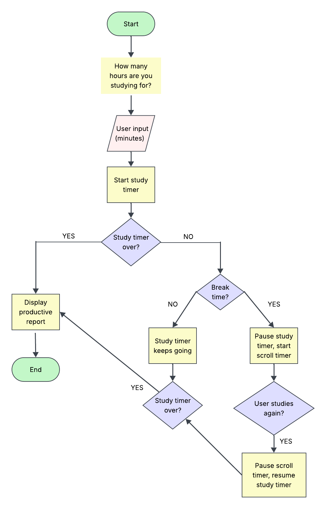

# Study-vs-Scroll-Tracker
A Java-based productivity tracker that helps students monitor their study habits by comparing the time spent studying and doomscrolling.

## Problem
Many students get distracted from studying by doomscrolling through social media. Students may plan to study for a certain amount of time but end up spending a significant portion of that time doomscrolling. This project aims to help students become more aware of their habits by tracking how much time they actually spend studying versus scrolling.

## How It Works
Students enter their desired study duration in minutes and use three timers to track their productivity:

1. Overall Timer: Counts down continuously from the user's desired duration, regardless of whether they are studying or doomscrolling. Once it reaches zero, the program records how much of the originally planned duration was spent studying versus scrolling.
2. Study Timer: Counts down from the user's desired duration but pauses whenever they switch to scrolling mode. It resumes when the user returns to studying and determines when the session is complete.
3. Scrolling Timer: Counts up whenever the user switches to scrolling mode and pauses when they return to studying. This timer has no predetermined time limit.

When the Study Timer reaches zero, the program displays two productivity reports:

- Original Duration Report: Shows the minutes and percentages spent studying versus doomscrolling during the originally planned study duration.
- Final Session Report: Shows the total minutes and percentages spent studying versus doomscrolling throughout the entire session, including time beyond the originally planned duration.



## Tech Stack
- Language: Java
- Development Environment: IntelliJ IDEA

## Setup
Prerequisites:
- Download Java Development Kit (JDK)
- Download IntelliJ IDEA
- Download Git

1. Open Terminal and clone the repository: *git clone https://github.com/rebeccasandrugu14/Study-vs-Scroll-Tracker.git*
2. Navigate to the project directory: *cd Study-vs-Scroll-Tracker*
3. Open IntelliJ IDEA.
4. Select File, then *Open* and choose the *Study-vs-Scroll-Tracker* folder.

## Usage
1. Enter the date & the desired study duration in minutes.
2. Begin studying while the Overall Timer and Study Timer count down.
3. Switch to scrolling mode by typing B when taking a break. The study timer pauses, while the scrolling timer begins tracking time spent doomscrolling. The overall timer continues counting down.
4. Switch back to studying mode by typing S to resume the Study Timer.
5. Continue until the Study Timer reaches zero.
6. View two productivity reports at the end of the session.

Example:
```text
Welcome to Study-vs-Scroll-Tracker!
Enter date (xx/xx/xxxx): 11/1/26
Enter desired study duration (minutes): 60

Study Session Started!

Overall Timer: 60:00
Study Timer: 60:00
Scrolling Timer: 00:00

Press S (resume studying) or B (take a scroll break): B

...

Study Session Complete!

--- Original Duration Report ---
Original Duration: 60 minutes
Time Studying: 30 minutes (50%)
Time Doomscrolling: 30 minutes (50%)

--- Final Session Report ---
Total Time: 90 minutes
Total Study Time: 60 minutes (66.7%)
Total Doomscrolling Time: 30 minutes (33.3%)
```

## Roadmap
Future Development:
- Users set scrolling time limits
- Display productivity trends over time for users to monitor their progress

## Author
Rebecca Sandrugu: [GitHub Link](https://github.com/rebeccasandrugu14)
